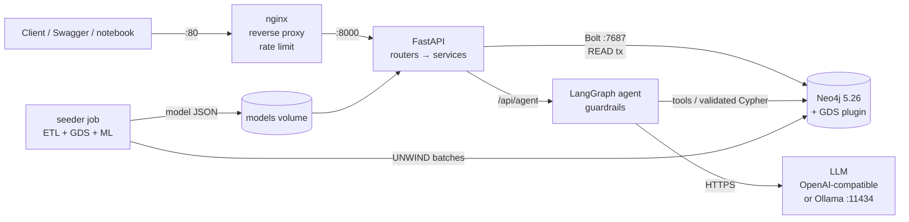
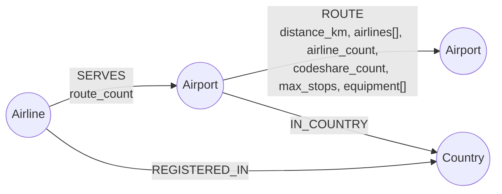
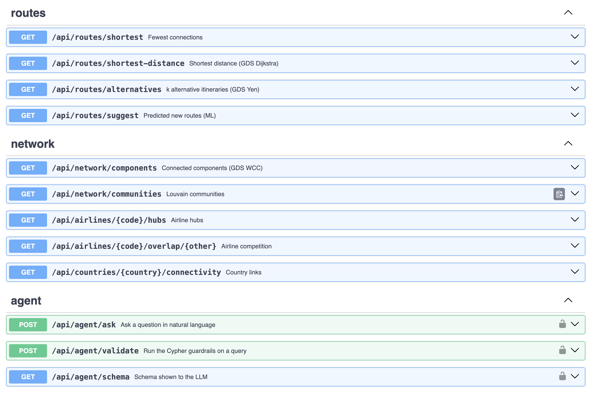
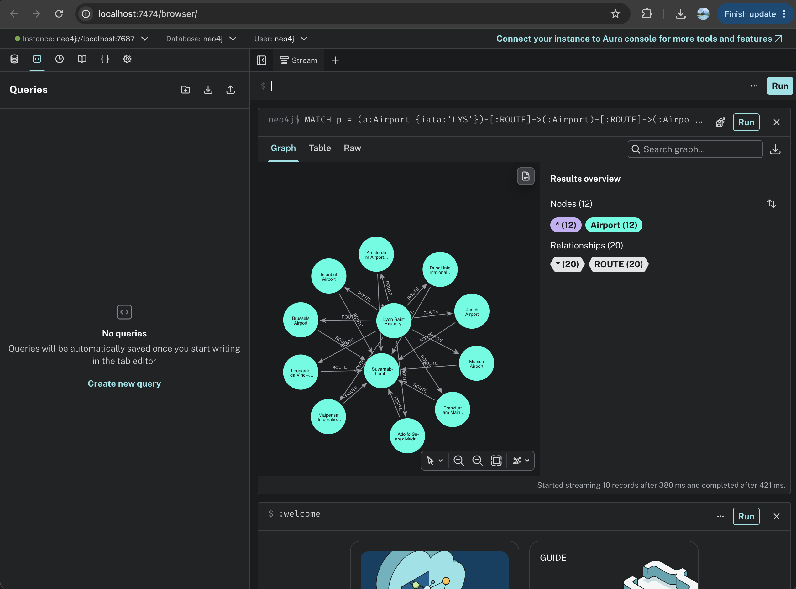
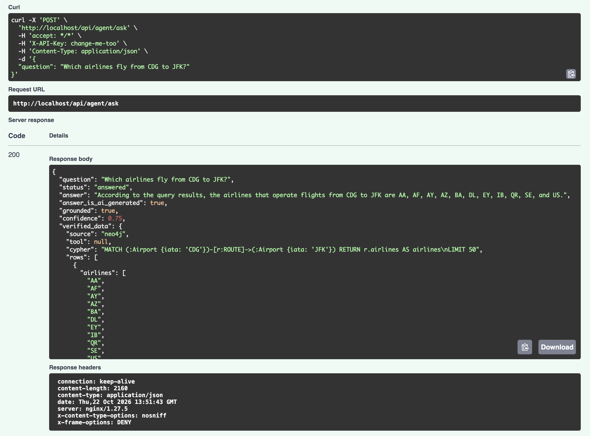

# ✈️ Flight Graph Explorer


Graph-backed API over the **world air-route network** (OpenFlights: 6,072 airports, 37,041 routes,
545 airlines). It answers routing, connectivity and centrality questions with Neo4j, Graph Data
Science and a guarded natural-language agent.

> GraphDB project, AIDAMS 3A, Level 1 subject #2 "Global Flight Network Explorer".

**Contents:** [Quick start](#quick-start) · [Architecture](#architecture) · [Graph schema](#graph-schema) ·
[API](#api) · [Agent & guardrails](#agent--guardrails) · [GDS & ML](#gds--ml) ·
[Optimisation](#optimisation) · [Tests](#tests--quality) · [Makefile](#makefile) · [Team](#team-contributions)

---

## Quick start

```bash
git clone https://github.com/Lio0704/flight-graph-explorer.git && cd flight-graph-explorer
cp .env.example .env          # set NEO4J_PASSWORD, API_KEY and your LLM settings
make docker-run               # neo4j + seeder + api + nginx
```

The first start downloads the GDS plugin, then the one-shot `seeder` container loads the data,
runs the GDS algorithms and trains the route-prediction model (~1-2 min). Then open:

| URL | What |
|---|---|
| http://localhost/docs | Swagger UI (through nginx) |
| http://localhost:8000/docs | Swagger UI (direct) |
| http://localhost:7474 | Neo4j Browser |

**Without a paid LLM:** set `LLM_PROVIDER=ollama` and run `docker compose --profile ollama up`, then
`docker compose exec ollama ollama pull qwen2.5:7b`. Or `LLM_PROVIDER=mock` for a deterministic fake
model (tests and offline demos).

**Local development** (API on the host, Neo4j in Docker):
```bash
make install
docker compose up -d neo4j
make seed analytics train
make run
```

Docker image: `docker pull lio0704/flight-graph-api:latest` → https://hub.docker.com/r/lio0704/flight-graph-api

---

## Architecture



| Service | Image | Port | Role |
|---|---|---|---|
| `neo4j` | `neo4j:5.26-community` + GDS | 7474, 7687 | graph store, in-memory projections |
| `seeder` | our image | – | one-shot: ingestion, GDS write-back, model training |
| `api` | our image ([Dockerfile](Dockerfile)) | 8000 | FastAPI |
| `nginx` | `nginx:1.27-alpine` | 80 | reverse proxy, security headers, rate limit (6 req/min on the agent) |
| `ollama` (optional profile) | `ollama/ollama` | 11434 | local LLM |

Code layout:
```
app/
  main.py            app factory, error handlers
  config.py          settings from env / .env
  dependencies.py    DI + API-key auth
  database/          Neo4j client (read / write / auto-commit / explain / profile)
  queries/           all Cypher (cypher.py) + schema, constraints, indexes (schema.py)
  services/          airports, routes (pathfinding + ML), network (GDS, airlines, countries)
  routers/           HTTP layer only
  agent/             graph.py (LangGraph), tools.py, guardrails.py, llm.py, prompts.py
scripts/             etl.py, seed_data.py, run_gds.py, train_link_predictor.py, benchmark_queries.py, eval_agent.py
tests/               unit, API, agent, static Cypher, integration
docs/                modeling.md, guardrails.md, benchmarks.md, agent_eval.md, diagrams
```

---

## Graph schema



* **Airport** `iata` (unique), icao, name, city, latitude, longitude, location (point), altitude_ft,
  timezone, continent, search_text, in/out_degree, nbr_count, pagerank, betweenness, community
* **Airline** `openflights_id` (unique), name, iata, icao, callsign, active
* **Country** `name` (unique), iso_code

Why a route is a relationship and not a node, why Country is a node but City is not, how continent
is derived, **why a graph rather than SQL** (recursive CTE vs Cypher for "reachable within 4
connections"), and the comparison with an AI-generated schema: **[docs/modeling.md](docs/modeling.md)**.
Editable diagrams: [docs/diagrams/](docs/diagrams/) (draw.io).

## Dataset

[OpenFlights](https://github.com/jpatokal/openflights/tree/master/data) (ODbL), snapshot in `data/raw/`:
`airports.dat`, `routes.dat`, `airlines.dat`, `countries.dat`. Chosen because it is real,
documented, large enough for meaningful graph algorithms, and naturally a graph (routes = edges).
Cleaning (dropped rows and why) is logged by the seeder and documented in the modeling doc.

---

## API

All endpoints are documented in Swagger (`/docs`). Errors: 404 unknown entity, 422 invalid
parameters, 401 missing API key, 503 database / GDS / model unavailable.

| Endpoint | Technique |
|---|---|
| `GET /health` | connectivity check (Docker healthcheck) |
| `GET /api/stats` | count store |
| `GET /api/airports?search=&continent=&skip=&limit=` | TEXT index, pagination |
| `GET /api/airports/nearby?lat=&lon=&radius_km=` | POINT index |
| `GET /api/airports/{iata}` | COUNT / COLLECT subqueries |
| `GET /api/airports/{iata}/reachable?hops=1..4` | quantified path + `ANY SHORTEST` (BFS) |
| `GET /api/airports/central?metric=degree\|pagerank\|betweenness&continent=` | live degree / GDS scores |
| `GET /api/routes/shortest?from=&to=` | `allShortestPaths` (fewest connections) |
| `GET /api/routes/shortest-distance?from=&to=` | **GDS Dijkstra** (km) |
| `GET /api/routes/alternatives?from=&to=&k=` | **GDS Yen** k-shortest paths |
| `GET /api/routes/suggest?iata=` | **ML link prediction** |
| `GET /api/network/components?continent=` | **GDS WCC** on a Cypher projection |
| `GET /api/network/communities` | **GDS Louvain** results |
| `GET /api/airlines/{code}/hubs` | SERVES relationship |
| `GET /api/airlines/{code}/overlap/{other}` | complex pattern + subquery |
| `GET /api/countries/{name}/connectivity` | `CALL` subquery, `WITH`, `UNWIND`, aggregations |
| `POST /api/agent/ask` 🔒 | LangGraph agent |
| `POST /api/agent/validate` 🔒 | guardrails only (demo) |

Examples:
```bash
curl "localhost/api/routes/shortest?from=LYS&to=SYD"
curl "localhost/api/routes/shortest-distance?from=CDG&to=SYD"
curl "localhost/api/airports/CDG/reachable?hops=2"
curl "localhost/api/airports/central?metric=pagerank&continent=Europe&limit=5"
curl "localhost/api/network/components?continent=Oceania"
curl "localhost/api/routes/suggest?iata=LYS"
curl -X POST localhost/api/agent/ask -H "X-API-Key: $API_KEY" -H "Content-Type: application/json" \
     -d '{"question": "How do I get from Lyon to Bangkok with the fewest connections?"}'
```

| Swagger | Neo4j Browser | Agent |
|---|---|---|
|  |  |  |

---

## Agent & guardrails

`POST /api/agent/ask` runs a **LangGraph** workflow: input guard → LLM plan (vetted tool *or*
Cypher *or* refusal, as JSON) → validation → execution in a READ transaction → LLM answer →
grounding check. Invalid plans are sent back to the LLM with the exact error (max 3 attempts).

14 checks, including read-only clauses, no procedures, **schema allow-lists that catch
hallucinated labels / properties**, bounded traversals, enforced LIMIT, `EXPLAIN`, READ
transaction with timeout, and a grounding check of the final answer. The response separates
**verified rows from Neo4j** from the **AI-generated wording**, with a confidence score and the
full trace.

Details, demo commands and limitations: **[docs/guardrails.md](docs/guardrails.md)**.
Evaluation (`make eval-agent`): **[docs/agent_eval.md](docs/agent_eval.md)**.

---

## GDS & ML

* **Projections:** `routes` (directed, weighted by `distance_km`, kept in memory for the API),
  `routes_undirected` (Louvain/WCC), and per-request Cypher projections for one continent.
* **Algorithms:** PageRank, betweenness (sampled), Louvain, WCC, Dijkstra, Yen.
  PageRank over degree because a feeder airport with many small routes is not a hub;
  betweenness for transfer chokepoints; Louvain to compare network communities with continents.
* **ML (link prediction):** "which direct routes are likely to open?". Features: common neighbours,
  Adamic-Adar, Jaccard, preferential attachment, distance, same country. Leakage-free protocol (20%
  of edges hidden, features on the remaining graph, half "hard" 2-hop negatives), logistic
  regression. Offline result on this dataset: **ROC-AUC 0.93** vs 0.88 for a common-neighbours
  baseline. Model stored as JSON (no pickle). Predictions are labelled as hypotheses.

## Optimisation

`make benchmark` PROFILEs naive vs optimised versions of 5 queries and writes
**[docs/benchmarks.md](docs/benchmarks.md)** (db hits, latency, plan operators): label + unique
index, TEXT index vs `toLower()`, SERVES vs list scan, POINT index vs computed distance (gains of
x100 to x4,000 in db hits), and one case where **our hypothesis was wrong**: for reachability, Neo4j's
pruning variable-length expand beat our `ANY SHORTEST` rewrite (kept because it returns hop levels,
see the modeling doc). All queries are parameterised, paginated or limited,
and avoid Cartesian products (separate `MATCH` on indexed keys).

---

## Tests & quality

```bash
make test              # 160+ tests, coverage report (DB tests auto-skip if Neo4j is down)
make test-integration  # same Cypher against the real seeded database + container health
make lint              # pylint 10.00/10 with the course .pylintrc
```

* **Unit / API:** FastAPI `TestClient` + in-memory fake Neo4j client (validation, errors, auth).
* **Agent:** deterministic fake LLMs (scripted good / bad outputs, retries, injection).
* **Static Cypher tests:** every API query must itself pass the agent guardrails (schema
  allow-list, bounded paths), be parameterised, and every MERGE must hit a constraint.
* **Integration:** real Neo4j: indexes exist, TEXT index used, Dijkstra = Yen #1, READ transaction
  refuses writes, `/health` through nginx.
* **CI:** GitHub Actions `lint.yml` and `test.yml` (unit job + integration job with a Neo4j service).

## Makefile

```
make help             list all commands
make install          venv + requirements
make run              API on the host (:8000)
make docker-run       full stack (foreground) · docker-up / docker-down / docker-logs
make docker-push      push the API image (IMAGE_NAME in .env)
make seed | analytics | train | benchmark | eval-agent
make test | test-unit | test-integration | lint | format | clean | tree | notebook
```

## Demo notebook

[`demo.ipynb`](demo.ipynb): graph statistics, degree distribution, PageRank vs degree, Louvain
communities on a world map, reachability curves, a route visualised, agent calls including a
rejected one. `make notebook`.

---

## Team & workflow

Individual project (approved by the instructor): **Lio Wang** ([@Lio0704](https://github.com/Lio0704)),
all modules.

Git workflow: `main` as the stable branch, one feature branch per module merged through a Pull
Request (`feat/ingestion`, `feat/api`, `feat/gds-ml`, `feat/agent`, `feat/docker-ci`, `docs/final`),
conventional commits (`feat:`, `fix:`, `test:`, `docs:`, `refactor:`, `chore:`), CI on every PR.
See [closed pull requests](https://github.com/Lio0704/flight-graph-explorer/pulls?q=is%3Apr+is%3Aclosed)
and `git log --oneline --graph`.

## Disclaimer

Educational project. OpenFlights data is a historical snapshot and not suitable for real travel
planning. Predicted routes are statistical hypotheses.
